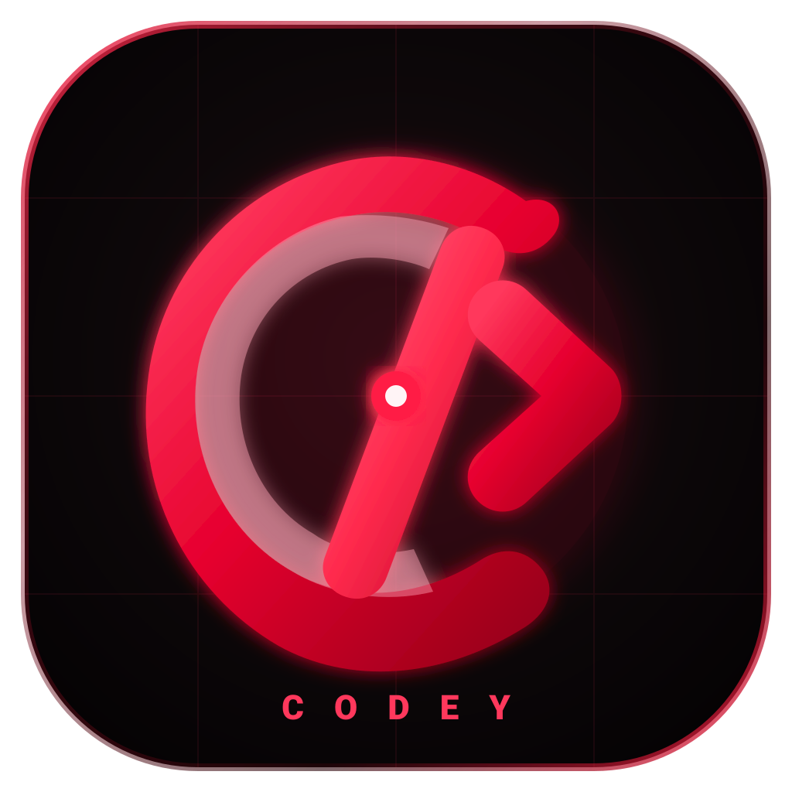
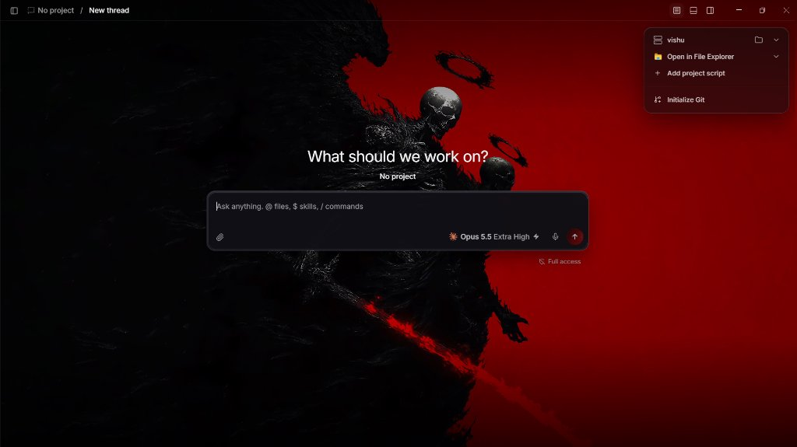
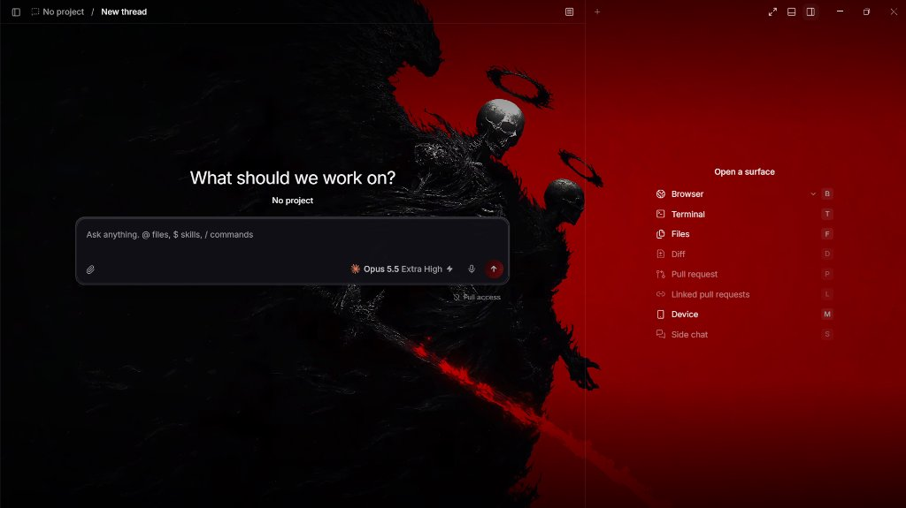

<div align="center">

  

# Codey

**Your Autonomous AI Coding Studio & Intelligent Development Harness**

[](https://github.com/vishu6213/codey/releases)
[](LICENSE)
[](<>)
[](https://github.com/vishu6213/codey/stargazers)

  <br />

[**Download Desktop App**](https://github.com/vishu6213/codey/releases) • [**Documentation**](docs/README.md) • [**Report Bug**](https://github.com/vishu6213/codey/issues) • [**Discussions**](https://github.com/vishu6213/codey/discussions)

</div>

---

## 📸 Screenshots

<div align="center">
  
  <br /><br />
  
</div>

---

## ⚡ What is Codey?

**Codey** is a modern, high-performance, local-first AI software engineering studio. It consolidates multiple autonomous coding agents, live terminal supervision, visual code reviews, and project memory into a unified, distraction-free environment.

Instead of switching between disjointed browser tabs, command line scripts, and editor extensions, Codey gives you a single mission control center. Prompt agents to autonomously read codebases, generate multi-file features, execute automated test suites, and review side-by-side git diffs with total control and speed.

---

## 🌟 Key Features

- 🧠 **Multi-Agent & Multi-Model Intelligence**  
  Seamlessly switch between top-tier coding engines (Gemini / Antigravity, Claude 3.7 Sonnet, OpenAI Codex / GPT-4o, Grok, and local models) in real-time within the same session.

- 🔒 **100% Local-First & Sovereign Privacy**  
  Your code, credentials, and conversation data remain strictly on your local machine. All workspace history is indexed in an ultra-fast SQLite database located at `~/.codey/userdata/statev2.sqlite`.

- 🗄️ **AI Vault & Instant Knowledge Recall**  
  Codey’s built-in **AI Vault** continuously indexes every prompt, conversation thread, code solution, and execution trace for instant full-text search. Never lose track of an agent conversation or debug sequence.

- 🌿 **Git Worktrees & Safe Sandbox Iteration**  
  Run agent tasks safely in isolated Git worktrees. Inspect changes in an interactive side-by-side diff viewer and test builds without polluting your primary working tree.

- 💻 **Real-Time Terminal & Process Supervisor**  
  Built-in pseudo-terminal (PTY) runner with live output streaming, automatic process management, error capture, and resource monitoring.

- 🖥️ **Desktop, Web & Mobile Ready**  
  Use Codey as a native desktop application on Windows, macOS, and Linux, or run it headlessly and connect from any modern web browser or mobile client.

---

## 🤖 Supported Models & Engines

Codey provides first-class support for industry-leading AI models and local LLM runtimes:

| Engine / Provider               | Key Capabilities                                                                |
| :------------------------------ | :------------------------------------------------------------------------------ |
| **Google Antigravity & Gemini** | Gemini 2.5 Flash / Pro, multimodal reasoning, lightning-fast context processing |
| **Anthropic Claude**            | Claude 3.7 Sonnet, Claude 3.5 Haiku, multi-file agentic reasoning               |
| **OpenAI Codex / GPT**          | GPT-4o, specialized coding runtimes, function calling                           |
| **Cursor Agent**                | Codebase-wide refactoring, iterative semantic indexing                          |
| **OpenCode & Local Models**     | Open-source models, Ollama endpoints, self-hosted LLM setups                    |
| **Grok Build**                  | High-speed code synthesis and algorithmic problem solving                       |

---

## 🚀 Quick Start

### 1. Standalone Desktop App (Recommended for Windows)

1. Download the latest installer from [Releases](https://github.com/vishu6213/codey/releases):
   - **`Codey-0.1.7-x64.exe`**
2. Run the installer. Codey comes pre-bundled with everything required to get started right away.
3. Launch **Codey** from your Start Menu or Desktop shortcut.

### 2. Using the CLI

Run Codey directly in any folder using the CLI:

```bash
# Start the local Codey server and open the web studio
codey
```

Or via npx:

```bash
npx codey
```

---

## 🏗️ Monorepo Architecture

Codey is architected as an optimized, modular monorepo:

```
codey/
├── apps/
│   ├── desktop/       # Native Electron desktop application
│   ├── server/        # High-throughput backend server, PTY supervisor, SQLite store
│   ├── web/           # React + Tailwind + Effect UI workspace application
│   ├── marketing/     # Documentation & product landing application
│   └── mobile/        # React Native / Expo companion app
├── packages/
│   ├── client-runtime/# State projections, timeline management & sync engine
│   ├── contracts/     # End-to-end TypeScript RPC schema & Effect contracts
│   ├── provider-core/ # AI model connectors, agent runtimes & execution harnesses
│   └── shared/        # Shared core utilities, git management & platform helpers
└── scripts/           # Build automation & multi-platform packaging pipeline
```

---

## 🛠️ Building & Contributing

### Prerequisites

- Node.js (v20+ recommended)
- `vp` (Vite+) package manager

### Setup & Run

```bash
# 1. Clone the repository
git clone https://github.com/vishu6213/codey.git
cd codey

# 2. Install workspace dependencies
vp install

# 3. Start development servers (Web & Server)
npm run dev

# 4. Start Electron desktop application in dev mode
npm run dev:desktop
```

### Building Production Binaries

```bash
# Build production client and server bundles
npm run build

# Package standalone Windows (.exe) desktop installer
npm run dist:desktop:win:x64
```

The resulting binary will be output to `release/Codey-0.1.7-x64.exe`.

---

## 💾 Local Storage & Privacy

All local configuration and history are kept isolated on your disk:

- **Root Directory:** `~/.codey/` (Windows: `%USERPROFILE%\.codey`)
- **Conversation State:** `~/.codey/userdata/statev2.sqlite`
- **Application Preferences:** `~/.codey/userdata/settings.json`

Your code never leaves your computer unless you explicitly choose to invoke external cloud provider endpoints.

---

## 📄 License

Codey is open-source software licensed under the **[MIT License](LICENSE)**.
